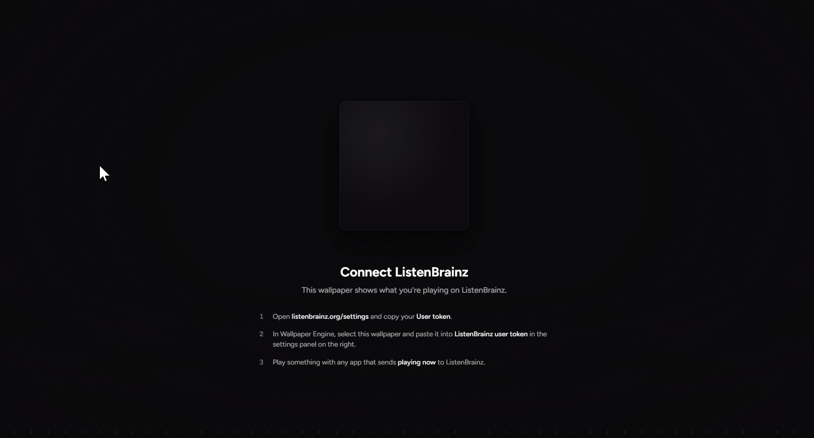
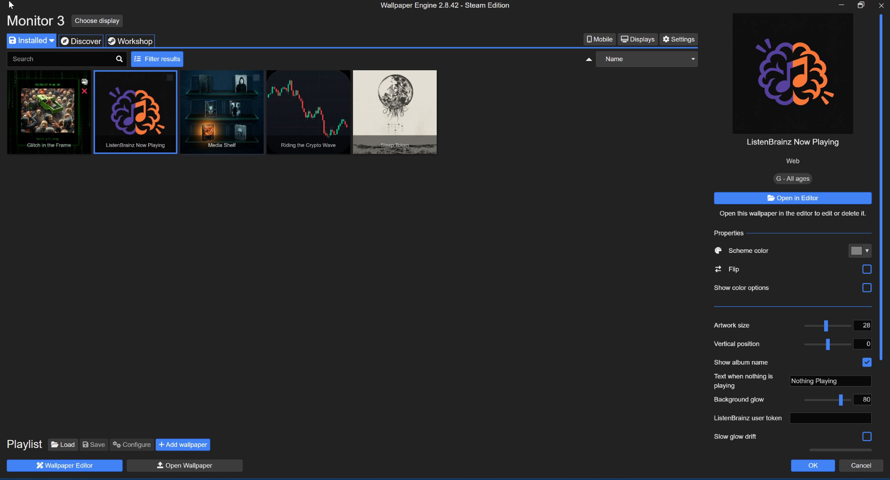
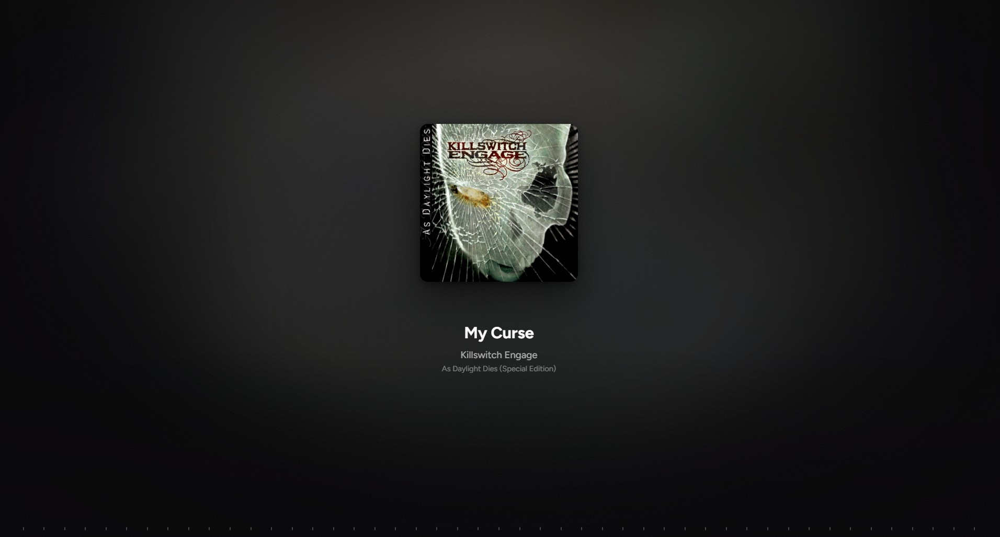

# Ambient Now Playing — Wallpaper Engine (ListenBrainz)

## Screenshots

## Install
1. Unzip this folder into
   `…\Steam\steamapps\common\wallpaper_engine\projects\myprojects\`
   (so you end up with `myprojects\ambient-now-playing\project.json`).
2. Restart Wallpaper Engine. It appears under **Installed**.
3. Select it and, in the settings on the right, paste your token into
   **ListenBrainz user token**. Get it from https://listenbrainz.org/settings/
   ("User token").

## How it works (no polling)
- Once, when the token is entered: ListenBrainz says who the token belongs to.
- The wallpaper then opens ListenBrainz's live connection (the same one listenbrainz.org
  uses for its live updates) and joins your user's channel. ListenBrainz pushes a
  "playing now" message the moment your player reports a new song; the wallpaper just
  listens.
- One "what's playing?" request at start-up and after a reconnect, to catch up.
- For each new song, the cover is found the same way listenbrainz.org finds it for its
  "Listening now" card:
  1. a release the scrobbler sent itself (or that release's album group),
  2. ListenBrainz's lookup by artist + title (needs the token), then that album group,
  3. the same lookup with the album name,
  4. the YouTube thumbnail, if the scrobbler sent a YouTube link.
  Covers come from the Cover Art Archive (album groups via MusicBrainz). Nothing found →
  a plain dark square, tried again after 30 minutes if the song comes back.
- ListenBrainz sends nothing when a song stops: it just drops "playing now" after the
  song's length (10 minutes if the player didn't send a length). The wallpaper keeps the
  same timer, so it returns to "Nothing Playing" when ListenBrainz does.
- A token saved in the settings is used as soon as the wallpaper loads. If ListenBrainz
  can't be reached or refuses it at that moment, the wallpaper keeps trying by itself
  (right away when the network comes back or the wallpaper resumes), so you never have to
  clear and re-enter the token.
- If the connection drops it reconnects (2 s, 4 s, 8 s … up to 2 minutes apart, only
  while disconnected). After Wallpaper Engine has paused it for over 30 s (game or
  full-screen app), it catches up once.
- No token yet → a setup screen with the three steps. Wrong token → the same screen,
  saying the token didn't work. No connection → "Reconnecting…" under "Nothing Playing".

ListenBrainz's "playing now" has no timestamps or pause state, so there's no progress
line or "Paused". If you pause, the song stays up until ListenBrainz drops it.

Note: the live connection isn't part of ListenBrainz's documented public API. If they
change it, the wallpaper would show "Reconnecting…" until it's updated.

## Your token
It's saved only in Wallpaper Engine's settings on your PC and is sent only to
api.listenbrainz.org. It's never in this folder, so sharing the folder or uploading it
to the Workshop doesn't share your token. Anyone else using it enters their own.

## Settings
Token, artwork size, vertical position, album name on/off, idle text,
glow strength, slow glow drift, marker colour (from the cover or custom), markers on/off,
markers that react to your PC's audio.

## Preview in a browser
Open `index.html?demo` (also `?demo=amber`, `teal`, `cycle`, `idle`, `notoken`,
`badtoken`, `offline`, `nocover`). This uses a fake ListenBrainz (API and live connection) and generated covers.
`demo.js` is never loaded inside Wallpaper Engine.

Font: Figtree (SIL Open Font License, see `fonts/OFL.txt`).
